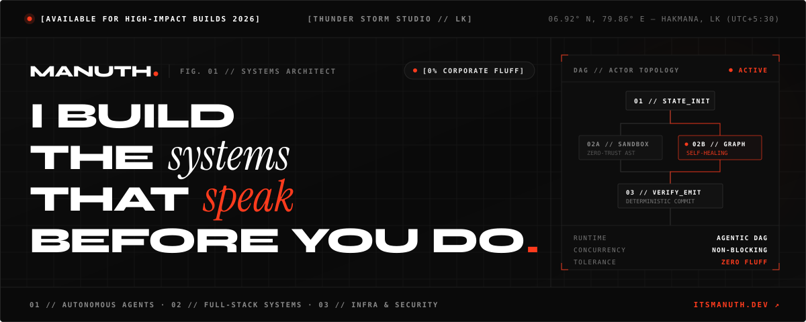
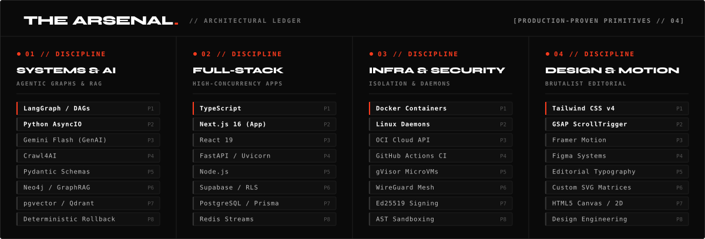

  

### `01 / MANIFESTO`

> **Stripping away fragile wrappers and superficial abstractions. Architecting autonomous systems, self-healing agent swarms, and high-concurrency foundations built for real-world load.**

Every system begins at its failure boundary — memory isolation, concurrency backpressure, and deterministic state verification. Across **Thunder Storm Studio**, I design and ship end-to-end production architecture: **autonomous AI workflows** that recover when downstream services degrade, **full-stack applications** built for sustained throughput, **zero-trust infrastructure**, and **silent automation daemons** that hold up under real load.

---

### `02 / SELECTED WORK`

| Project | Architecture | Core Stack | Link |
| :--- | :--- | :--- | :--- |
| **`Tutes-Delivery-Tracking-System`** | Production parcel-tracking engine with an in-memory SL Post CAPTCHA solver, bulk dispatch ingestion, and full Sinhala localization. | `Next.js 16` · `TypeScript` · `Supabase` · `PostgreSQL` | [Repo ↗](https://github.com/manuthlochana/Tutes-Delivery-Tracking-System) · [Live ↗](https://mediatutes.vercel.app) |
| **`Item-scraper` (Smart Sentry)** | Autonomous self-healing scraping DAG that classifies page states in real time, evades bot traps and cyclic loops, and emits strictly validated schemas. | `Python` · `Crawl4AI` · `Gemini Flash` · `Pydantic` · `Redis` | [Repo ↗](https://github.com/manuthlochana/Item-scraper) |
| **`Subtitle-Translator`** | English-to-Sinhala SRT localization engine pairing native colloquial screenwriter prompting with a 3-Layer Unicode Defense System. | `TypeScript` · `React 19` · `Vite` · `Gemini` · `Node.js` | [Repo ↗](https://github.com/manuthlochana/Subtitle-Translator) |
| **`num2vcf`** | Zero-server, client-side batch sanitizer and deduplicator converting bulk raw numbers into RFC-compliant vCard 3.0 bundles. | `TypeScript` · `React 19` · `Vite` · `Tailwind CSS` | [Repo ↗](https://github.com/manuthlochana/num2vcf) · [Live ↗](https://num2vcf.vercel.app) |
| **`ORL-Free-Vps-`** | Autonomous OCI capacity-acquisition daemon featuring dual-shape targeting (`A1.Flex` / `E2.1.Micro`) and anti-detection randomized jitter. | `Python` · `OCI SDK` · `Paramiko` · `Linux` | [Repo ↗](https://github.com/manuthlochana/ORL-Free-Vps-) |

---

### `03 / ARSENAL`

  

---

### `04 / INITIATE DIALOGUE`

  

  <code><a href="https://www.itsmanuth.dev">PORTFOLIO ↗</a></code>
  &nbsp;&nbsp;·&nbsp;&nbsp;
  <code><a href="mailto:manuth.dev@gmail.com">MANUTH.DEV@GMAIL.COM ↗</a></code>
  &nbsp;&nbsp;·&nbsp;&nbsp;
  <code><a href="https://www.linkedin.com/in/manuth-lochana/">LINKEDIN ↗</a></code>
  &nbsp;&nbsp;·&nbsp;&nbsp;
  <code><a href="https://x.com/manuthlochana">X / @MANUTHLOCHANA ↗</a></code>

